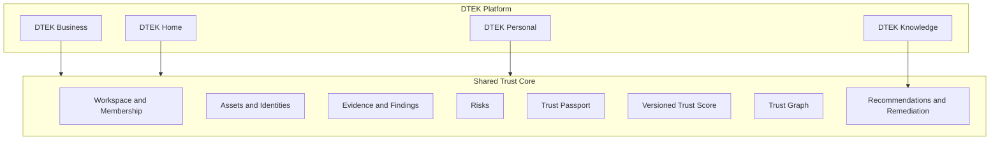
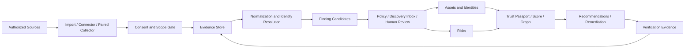
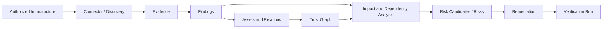
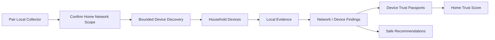
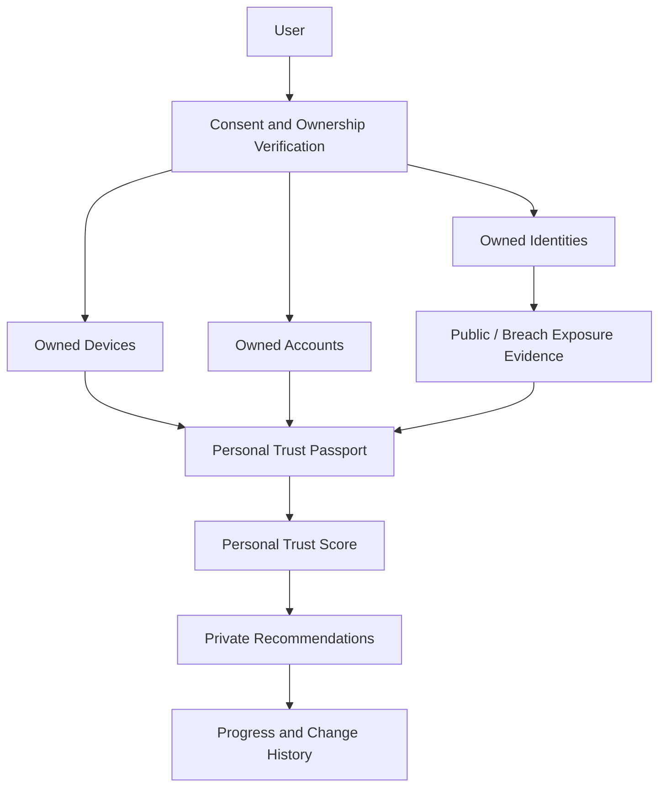

# DTEK Platform Architecture

`Статус: target architecture / production implementation not started`
`Дата: 24.10.2026`
`Совместимость: ADR-001–009; новое решение ADR-010`

---

## 1. Архитектурный Принцип

DTEK Platform остаётся modular monolith на Next.js + Supabase/PostgreSQL до тех
пор, пока измеренная нагрузка или scanner isolation не потребует выделенного
runtime. Новые product modes используют Shared Trust Core и не создают четыре
несвязанных приложения.



---

## 2. Layer Model



Ни connector, ни collector, ни public-intelligence provider не пишет напрямую
в Passport, Score, Graph или Risk Registry.

---

## 3. Workspace Evolution

### Current

`profiles.organization_id` определяет один Business tenant. Это нельзя просто
переименовать или использовать для Home/Personal без изменения RLS.

### Target

```text
Supabase Auth User
  -> Account/Profile
      -> Workspace Membership
          -> Workspace
              - business
              - home
              - personal
```

`Workspace` становится security boundary. Mode определяет policy, available
modules и score model, но не ослабляет isolation.

### Compatibility Migration

1. Security Gate закрывает текущие profile/RLS vulnerabilities.
2. Каждая существующая organization получает Business workspace с тем же UUID
   либо immutable 1:1 mapping, выбранным ADR Sprint 16.
3. Existing organization data остаётся business metadata; массовое destructive
   rename колонок не выполняется в первой migration.
4. Membership заменяет единственный `profiles.organization_id` постепенно.
5. Selected workspace определяется server-side и проверяется RLS; client mode
   или route parameter не является authorization source.
6. Personal workspace по умолчанию single-member; Home invitations используют
   отдельную ограниченную policy, Business сохраняет текущие роли.

---

## 4. Candidate Domain Model

Production tables сейчас не создаются. Названия уточняются ADR/migration review.

| Entity | Назначение | Existing Mapping |
|---|---|---|
| Account/Profile | Глобальная identity пользователя | `profiles` |
| Workspace | Tenant и product mode | `organizations` только для Business |
| Workspace Membership | Role/status per workspace | новая сущность |
| Organization Profile | Business metadata | `organizations` |
| Asset | Технический/цифровой объект | `objects` |
| Identity | Email/username/account/domain identity | новая сущность |
| Device | Asset specialization для Home/Personal | расширение Asset |
| Network | Scoped network context | новая сущность/Asset relation |
| Data Source | Import/connector/collector/provider | Evidence spec |
| Evidence | Immutable source observation/provenance | Evidence spec |
| Finding | Наблюдаемая проблема/condition | новая сущность |
| Risk | Контекстная оценка consequence/decision | `risks` |
| Trust Passport | Проекция доверия entity | `trust_passports` |
| Score Model | Versioned factors by workspace mode | config extension |
| Relation | Typed graph edge with provenance | `relations` |
| Recommendation | Reusable safe guidance | новая сущность |
| Remediation | Workspace action instance | новая сущность |
| Assessment | User-authorized intent and scope | новая сущность |
| Scan/Run | Bounded execution instance | новая сущность |
| Consent Grant | Purpose/scope/expiry evidence | новая сущность |
| Knowledge Article | Explanation/remediation/verification | новая сущность |

### Finding Types

- vulnerability;
- misconfiguration;
- exposure;
- missing control;
- suspicious/unsafe relation;
- dependency/single point of failure;
- breach/public exposure;
- stale/unverified evidence;
- operational resilience issue.

Finding хранит факт и evidence. Risk хранит интерпретацию вероятности,
последствий, ownership и acceptance. Finding может создать risk candidate, но
не обязан автоматически становиться принятым Risk.

---

## 5. Trust Model By Mode

| Mode | Passport Subject | Score Scope | Aggregate |
|---|---|---|---|
| Business | Infrastructure asset/service | ADR-001 compatible factors | Organization Trust Index |
| Home | Device/network component | device/network safety factors | Home Trust Score |
| Personal | Person-owned digital identity | identity/account/device/exposure factors | Personal Trust Score |

Shared engine contract включает version, factors, evidence coverage,
freshness, confidence и explanation. Формулы и thresholds versioned per mode.
Изменение Business formula не является побочным эффектом Home/Personal work.

---

## 6. Business Flow



Dependency/collision analysis работает на typed graph и evidence freshness. Он
может выявлять SPOF, absence of redundancy, dangerous exposure path и cascade
potential, но обязан показывать assumptions и не выдавать недоказанную
причинность.

---

## 7. Home Flow



Collector получает short-lived pairing credential, выполняется с least
privilege, не принимает arbitrary shell commands и отправляет только
allowlisted normalized observations. В Cloud не хранится полный packet capture
для Home MVP.

---

## 8. Personal Flow



Raw passwords, breach dumps, private messages и data of unrelated persons не
сохраняются и не отображаются. Provider response минимизируется до категории,
даты, confidence и safe source reference.

---

## 9. Assessment Execution Boundary

Assessment создаётся только после:

1. authenticated workspace membership;
2. explicit purpose and target scope;
3. ownership/authorization evidence appropriate to mode;
4. server-side policy check;
5. immutable audit event;
6. resource budget and expiry.

Execution rules:

- no arbitrary shell command or user-supplied flags;
- allowlisted adapters/check definitions;
- sandbox/isolated worker for active checks;
- signed job and collector identity;
- per-workspace and per-target rate/resource limits;
- destination validation on every redirect/resolution;
- deny cloud metadata, loopback and unrelated private ranges;
- bounded output, timeout, cancellation and safe error classes;
- raw payload quarantine before parser/normalizer;
- no direct business projection before Evidence/Review.

---

## 10. Deployment Evolution

| Stage | Runtime |
|---|---|
| Current | Next.js/Vercel + Supabase Cloud |
| Foundation | Same stack; migrations and bounded server jobs only |
| Connector MVP | Server-only orchestrator; provider-approved scheduler |
| Home discovery | Separate paired local collector, cloud control plane |
| Active assessment | Isolated worker/runner only after Sprint 19 security gate |
| Enterprise | On-prem/private-cloud decision remains future ADR |

The web process must not become a generic network scanner. Isolation is added
only when an admitted capability requires it.

---

## 11. Migration Rules

- Security & Stabilization Gate completes first.
- Existing applied migrations remain immutable.
- Each new tenant table includes `workspace_id`, composite tenant constraints,
  RLS, indexes, audit and two-workspace negative tests.
- Backfill is idempotent and reversible on a copy/restore target.
- Generated Supabase types are refreshed after schema changes.
- Business routes remain compatible during staged rollout.
- No Home/Personal data enters `organizations` by pretending to be a company.

---

## 12. Architecture Decision Gates

Implementation requires explicit ADR before:

- Workspace schema and selected-context mechanism;
- mode-specific score formula;
- scanner/worker isolation technology;
- Home collector transport/update model;
- breach/public-intelligence provider;
- notification provider;
- cross-region/personal-data storage;
- native apps or general-purpose agent.
