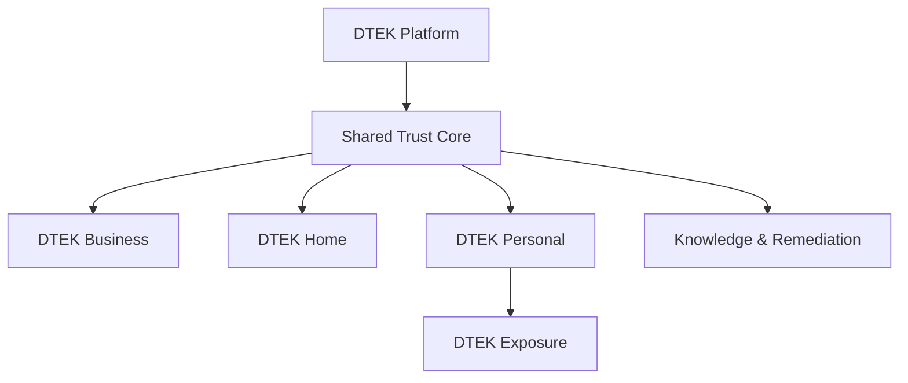
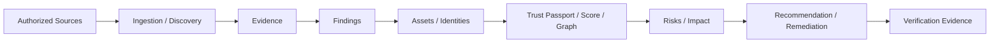

# Product & Business

## Product Promise

DTEK помогает понять:

```text
Что у пользователя есть
  -> Какие факты это подтверждают
  -> Какие проблемы обнаружены
  -> Чему можно доверять
  -> Каково влияние проблемы
  -> Что исправить
  -> Как проверить результат
```

## Product Family



| Mode | Для кого | Основная ценность | Статус |
|---|---|---|---|
| Business | CISO, ИБ, IT | Evidence-driven инфраструктура, trust и risk impact | Foundation implemented |
| Home | Домашний пользователь | Понять устройства и риски своей сети | Planned |
| Personal | Любой пользователь | Управлять собственной цифровой безопасностью | Planned |
| Exposure | Владелец identifiers/domains | Безопасно увидеть собственный digital exposure | Planned |
| Knowledge | Все режимы | Понять, исправить и проверить проблему | Planned |

## Shared Trust Core



## Business Model Hypotheses

| Segment | Offer | Validation |
|---|---|---|
| Russian SMB/mid-market | 2–4 week Business pilot | CISO usefulness, time-to-value, willingness to pay |
| Integrators/consultants | Repeatable assessment and executive report | Reuse across clients and delivery cost |
| Home | Guided home security assessment | Completion, useful findings, remediation rate |
| Personal | Trust Passport and exposure monitoring | Retention without fear-based dark patterns |

## Startup Questions

- Кто платит первым и за какой измеримый результат?
- Какие sources доступны у первых Business pilots?
- Какие findings пользователь реально исправляет?
- Как доказать качество Trust Score, а не только привлекательность UI?
- Какая Home/Personal capability даёт повторное использование?
- Какие provider/legal ограничения делают capability экономически невыгодной?

## Основные Документы

- [[docs/product/DTEK_PLATFORM_VISION|DTEK Platform Vision]]
- [[docs/product/PRODUCT_STRATEGY|Product Strategy]]
- [[docs/product/Product_Concept|Product Concept]]
- [[docs/product/MVP_Scope|MVP Scope]]
- [[docs/product/PILOT_OFFER|Pilot Offer]]
- [[docs/product/PILOT_METRICS_FEEDBACK_LOOP|Pilot Metrics]]
