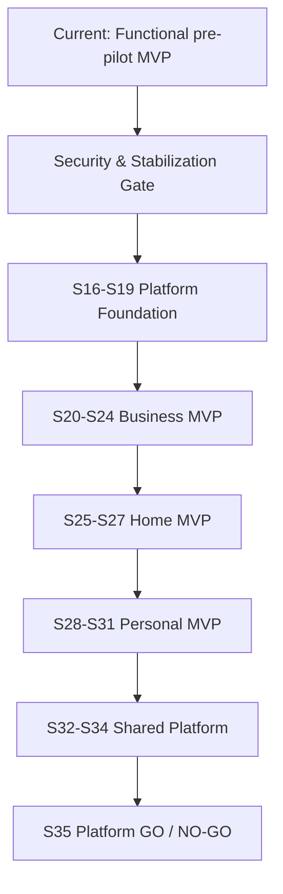

# Roadmap & Milestones

## Development Sequence

## Milestone Contracts

| Milestone | Пользователь может | Технически готово | Остаётся дальше |
|---|---|---|---|
| Stable Baseline | Безопасно использовать текущий Business MVP | Blocking findings, RLS tests, authenticated QA | Shared foundation |
| Foundation Ready | Работать в стабильном Business | Workspace/Evidence/Finding/Remediation/Assessment contracts | Runtime discovery |
| Business MVP | Подключить source, подтвердить findings, вести remediation | Connector runtime, discovery, impact, release evidence | Consumer modes |
| Home MVP | Проверить собственную сеть через paired collector | Household privacy, devices, Home score | Personal identity |
| Personal MVP | Проверить свои identities/exposure и получить actions | Consent, providers, Personal score, bounded intelligence | Unified platform |
| Platform MVP | Переключаться между modes с общим Knowledge | Governance, history, security/privacy GO | Enterprise/Post-MVP |

## Phase Gates

- [ ] Security & Stabilization Gate PASS.
- [ ] Foundation security/isolation gate PASS.
- [ ] Business source/release gate PASS.
- [ ] Home pairing/privacy gate PASS.
- [ ] Personal ownership/provider/legal gate PASS.
- [ ] Platform pentest/restore/incident gate PASS.

## Roadmap Rules

1. Один Task ID — один ограниченный рабочий цикл.
2. Следующий Sprint не начинается автоматически.
3. Home/Personal не расширяются до проверки Business foundation.
4. Документация не считается фактическим test evidence.
5. Неуспешная consumer-гипотеза не должна разрушать Business.
6. Native apps, broad agents, on-prem, SSO и marketplace находятся Post-MVP.

## Источники

- [[docs/roadmap/ROADMAP|Official Roadmap]]
- [[docs/roadmap/SPRINT_ROADMAP|Official Sprint Roadmap]]
- [[tasks/MVP_RELEASE_PLAN|MVP Release Plan]]
- [[tasks/EPIC_BACKLOG|Epic Backlog]]
- [[tasks/FEATURE_BACKLOG|Feature Backlog]]
