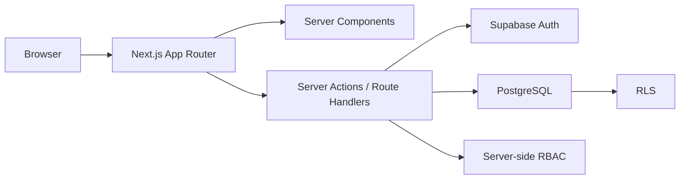
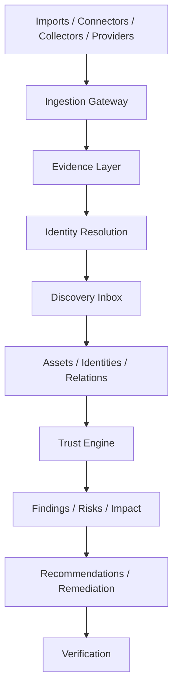

# Architecture & Security Map

## Current Runtime

## Target Platform Layers

## Domain Evolution

| Current | Planned extension | Правило |
|---|---|---|
| Organization | Workspace: Business/Home/Personal | Additive migration, не rename |
| Object | Asset/Device/Identity views | Canonical identity и tenant scope |
| Import source block | Evidence source/batch/assertion/binding | No direct connector business writes |
| Risk | Finding + contextual Risk | Finding не создаёт risk автоматически |
| Score | Mode-specific score models | Business ADR-001 сохраняется |
| Relation | Evidence-backed graph edges | Low-confidence не влияет без review |
| Manual action | Recommendation/Remediation/Verification | No autonomous remediation in MVP |

## Security Gates

| Surface | Главные угрозы | Roadmap control |
|---|---|---|
| Current Business | Privilege escalation, blocked-user bypass, cross-tenant links | Security Gate |
| Workspace | Cross-mode/tenant leakage | Sprint 16 + two-workspace tests |
| Connectors | Secrets, SSRF, hostile payload, confused deputy | Sprint 20–21 admission |
| Assessment | Command injection, resource abuse, unsafe scope | Sprint 19 sandbox/bounds |
| Home | Unauthorized LAN scanning, household privacy | Sprint 25–27 pairing/scope gate |
| Personal | PII/breach leakage, consent, retention | Sprint 28–30 privacy gate |
| Exposure | Doxxing, enumeration, SSRF, provider abuse | Sprint 31 capability controls |
| Knowledge | Unsafe remediation instructions | Sprint 18/32 content review |

## Source Documents

- [[ARCHITECTURE_DECISIONS]]
- [[docs/architecture/System_Architecture|Current System Architecture]]
- [[docs/architecture/DTEK_PLATFORM_ARCHITECTURE|Target Platform Architecture]]
- [[docs/architecture/DTEK_PLATFORM_GAP_ANALYSIS|Gap Analysis]]
- [[docs/architecture/Connector_Framework_Architecture|Connector Framework]]
- [[docs/architecture/Evidence_Layer_Data_Model|Evidence Data Model]]
- [[docs/security/SECURITY_OVERVIEW|Security Overview]]
- [[docs/security/DTEK_PLATFORM_SECURITY_PRINCIPLES|Platform Security Principles]]
- [[docs/security/CONNECTOR_SECURITY_MODEL|Connector Security Model]]
