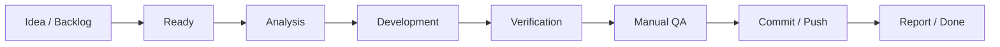

# DTEK Operating Model

## Роли

| Роль | Ответственность |
|---|---|
| Владелец проекта | Приоритеты, product decisions, ручная приёмка, GO/NO-GO |
| Codex | Анализ, реализация, tests, документация, Git и отчёт |
| Репозиторий | Технический источник истины |
| Obsidian cockpit | Планирование, контроль, идеи и управленческая отчётность |

## Жизненный Цикл Задачи

## Перед Началом Task ID

1. Карточка находится в `Ready`.
2. Есть ссылка на Sprint/task source.
3. Понятны scope, dependencies, risks и acceptance criteria.
4. Проверено отсутствие конфликтующих пользовательских изменений.
5. Для Gate/Security/DB задач подтверждено окружение и migration parity.

## После Завершения

1. Отметить карточку `Done` только после tests и push.
2. Внести commit hash и фактический результат.
3. Добавить найденный debt или blocker в соответствующую доску.
4. Обновить Sprint/report/Changelog по необходимости.
5. Не перемещать следующую задачу в `In Progress` автоматически.

## Команды Для Совместной Работы

Примеры запросов владельца:

- «Добавь идею Home Router Passport в Ideas».
- «Переведи SEC-01 в Ready и покажи план».
- «Начни SEC-01 по доске».
- «Добавь найденный баг в Bugs & QA».
- «Обнови Dashboard после завершения задачи».
- «Сформируй Sprint report и подготовь следующий handoff».

Codex перед реализацией читает изменённые вами management-файлы и учитывает
последний статус. Новейшая явная команда владельца имеет приоритет.

## Cadence

| Ритм | Что обновляется |
|---|---|
| После каждой задачи | Development Board, report, commit, blockers |
| После Sprint | Sprint status, QA, milestone, retrospective |
| Раз в неделю во время активной работы | Metrics, risks, ideas triage |
| Перед milestone release | Security/privacy/operations GO/NO-GO |
