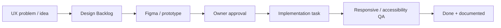

# Design & UX

## Design Sources

| Source | Role |
|---|---|
| `design/` | Утверждённый визуальный prototype/reference |
| [[tasks/disign/MINI_DESIGN_CHANGES|Mini Design Changes]] | Небольшие UI/UX improvements |
| [[tasks/disign/DESIGN_SPRINT_01_SETTINGS_PROFILE|Settings/Profile Design Sprint]] | Отдельный Figma-first scope |
| [[project-management/boards/DESIGN_BOARD|Design Board]] | Оперативный статус и новые design requests |

## Workflow

## Product UX Principles

- Первый экран — рабочий продукт, не marketing decoration.
- Business остаётся плотным и удобным для повторной работы.
- Home/Personal объясняют security без запугивания и ложной точности.
- Trust Score всегда сопровождается reason/evidence/coverage context.
- Finding показывает: что обнаружено, почему важно, что затронуто, как исправить.
- Мобильный интерфейс не должен скрывать critical actions или status.
- Одинаковые сущности используют общие компоненты, mode differences остаются явными.

## Figma Boundary

Figma используется для визуального проектирования и согласования. Production
code остаётся источником фактического поведения. После утверждения дизайна
создаётся отдельная implementation task; Figma не изменяет приложение сама.
