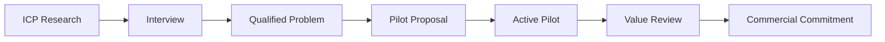

# Go-To-Market & Pilots

## First Commercial Wedge

Первый рынок — DTEK Business для российских компаний среднего размера, где
assets, risks и security reporting распределены между Excel, Jira, Confluence
и отдельными security systems.

Первое предложение:

> За 2–4 недели собрать evidence-backed модель 50–200 ключевых активов,
> показать Trust Score, наиболее влияющие риски и executive report.

## Funnel

## Pilot Gates

1. Security & Stabilization Gate PASS.
2. Release candidate and migration parity confirmed.
3. Authenticated role QA PASS.
4. Backup/restore and monitoring contacts ready.
5. Data scope, retention, support and closeout agreed.
6. Success metrics recorded before pilot starts.

## Evidence To Collect

- Time spent preparing import data.
- Number of accepted/rejected findings.
- Manual burden and missing source data.
- Usefulness of Trust Score explanations.
- Remediation decisions made from DTEK.
- Executive report usefulness.
- Requested connectors with concrete source/access details.
- Willingness to continue or pay.

## Source Documents

- [[docs/product/ICP_INTERVIEW_SCRIPT]]
- [[docs/product/PRODUCT_ONE_PAGER]]
- [[docs/product/PILOT_OFFER]]
- [[docs/product/PILOT_METRICS_FEEDBACK_LOOP]]
- [[docs/pilot/PILOT_DOCUMENTATION_PACK]]
- [[project-management/registers/PILOT_AND_CUSTOMER_REGISTER|Pilot Register]]
- [[project-management/registers/METRICS_REGISTER|Metrics Register]]
